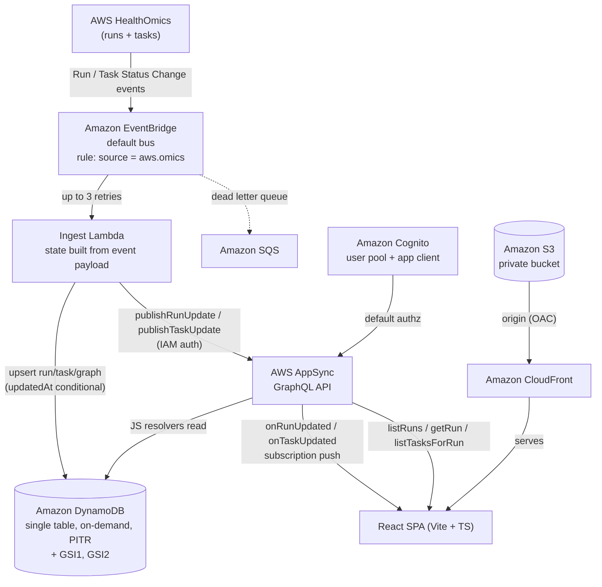

# AWS HealthOmics Workflow Dashboard

Near real-time run and task monitoring for AWS HealthOmics workflows, built
on serverless AWS services.

AWS HealthOmics publishes run and task status-change events to Amazon
EventBridge, which invokes an AWS Lambda ingest function. The ingest Lambda
builds run and task state from the event payload itself, calling HealthOmics
read APIs only in a few cases. It writes that state to a single Amazon
DynamoDB table and publishes each change through AWS AppSync, which pushes
live updates to a React single-page app (SPA) served from Amazon S3 through
Amazon CloudFront.

This TypeScript monorepo's packages each pin exact dependency versions and
have their own `build` and `test` scripts.

| Package | Purpose |
|---------|---------|
| `infra/` | AWS CDK v2 app with four stacks: `DataStack`, `ApiStack`, `IngestStack`, `FrontendStack`. |
| `ingest/` | Ingest Lambdas (TypeScript): event mapping, enrichment, persistence, publish, the deferred re-sweep, and the workflow-definition parsers. |
| `frontend/` | React and Vite SPA using the [Cloudscape Design System](https://cloudscape.design/). |
| `fixtures/` | Sample HealthOmics events and workflow definitions for tests and local checks. |
| `scripts/` | Deploy, local development, and operational scripts. See [`scripts/README.md`](scripts/README.md). |
| `cost-planning-assistant/`, `dist-cost-estimator/` | Standalone HealthOmics cost tools: pre-run planning and a per-run estimator. See each package's README. |

## Contents

- [Features](#features)
- [Architecture](#architecture)
- [Prerequisites](#prerequisites)
- [Quick start](#quick-start)
- [Configuration](#configuration)
- [Local development](#local-development)
- [Testing and verifying](#testing-and-verifying)
- [Troubleshooting](#troubleshooting)
- [Security](#security)
- [Cost](#cost)
- [Known limitations](#known-limitations)
- [Teardown](#teardown)
- [Contributing](#contributing)
- [License](#license)

## Features

- Fleet view: the run list with status, workflow, IDs, engine version, batch
  ID, start time, and duration. It has a date-range window (last 30 days by
  default), search, filters, sorting, grouping by engine version or batch,
  stale-run badges, a two-run parameter diff, and live updates.
- Run detail view: the task graph (True DAG from the workflow definition,
  inferred DAG, or timeline), a task detail panel with logs and error
  excerpts, resource summary, measured utilization, a per-run cost estimate,
  longest-running tasks, a task timeline, a failed-task filter, and the run's
  inputs, outputs, and configuration.
- Reports view: mean, median, and p90 statistics across runs of one workflow
  version over a time window, with histograms, drill-down to individual runs,
  and CSV or print-to-PDF export.

Every view is deep-linkable (`#/run/<id>`, `#/run/<id>/task/<id>`), and the UI
shows "unavailable" rather than guessing when data is missing. Details are in
[docs/features.md](docs/features.md).

## Architecture

The diagram shows the default configuration.



### Stacks

The AWS CDK app defines four stacks, split by lifecycle:

| Stack | Contents |
|-------|----------|
| `HealthOmicsData` (`DataStack`) | DynamoDB single table: on-demand, point-in-time recovery, deletion protection, `GSI1` (runs by recency), `GSI2` (workflow groups for Reports). |
| `HealthOmicsApi` (`ApiStack`) | AppSync API, schema, and JS resolvers; Lambda resolvers for logs and error excerpts, run metrics, cost estimates, and Reports; Cognito user pool and app client. |
| `HealthOmicsIngest` (`IngestStack`) | EventBridge rule; ingest Lambda and its dead letter queue; Reconciler Lambda and EventBridge Scheduler group for the deferred re-sweep; least-privilege IAM. Only when [Kinesis ingest](#optional-kinesis-buffer-kinesisingestmode) is enabled: Kinesis stream, Kinesis consumer Lambda, and Kinesis dead letter queue. |
| `HealthOmicsFrontend` (`FrontendStack`) | Private S3 bucket, CloudFront distribution with Origin Access Control, SPA routing, and deploy-time config injection. |

CDK deploys them in dependency order (Data → Api → Ingest, Api → Frontend).

### How ingest works

The EventBridge rule invokes the ingest Lambda for each `aws.omics` event,
with up to 3 retries before an event goes to the dead letter queue. With
event enrichment (`eventEnrichmentMode=event`, the default), task and run
state comes from the event payload. The ingest Lambda calls HealthOmics read
APIs only for:

- `GetRun` when a run reaches `PENDING` and when it reaches a terminal status,
  for parameters, configuration, and exact timestamps;
- `GetRunTask` for `FAILED` or `CANCELLED` tasks, because task events don't
  carry `statusMessage` or `failureReason`;
- `GetWorkflow` the first time a workflow version's graph is needed.

On a 207-task nf-core/rnaseq run that was 2 HealthOmics calls, compared with
217 on the legacy per-task path. Writes use a monotonic `updatedAt` guard, so
duplicate or out-of-order events never move state backward. When a run ends,
the ingest Lambda schedules a deferred re-sweep that corrects late task
states and utilization.

An optional Amazon Kinesis Data Streams buffer can sit between EventBridge and
ingest for very large batches; see
[Optional Kinesis buffer](#optional-kinesis-buffer-kinesisingestmode). It is
off by default and not shown in the diagram. Details, including the event
fields the mapper reads and the deferred re-sweep, are in
[docs/architecture.md](docs/architecture.md).

## Prerequisites

- An AWS account and credentials (`aws configure`, `AWS_PROFILE`, or
  environment variables) allowed to deploy AWS CloudFormation, IAM, AWS
  Lambda, Amazon EventBridge, Amazon EventBridge Scheduler, Amazon SQS, Amazon
  DynamoDB, AWS AppSync, Amazon Cognito, Amazon S3, Amazon CloudFront, Amazon
  CloudWatch, and Amazon CloudWatch Logs resources, plus Amazon Kinesis Data
  Streams if you enable the optional Kinesis buffer. Prefer least-privilege
  credentials.
- A region where HealthOmics is available (see
  [HealthOmics endpoints](https://docs.aws.amazon.com/general/latest/gr/healthomics-quotas.html)).
  Deploy into the same region (and, by default, the same account) as your
  HealthOmics runs.
- Lambda concurrency: the stacks reserve 402 concurrent executions (400 for
  the direct ingest Lambda, 2 for the Reconciler Lambda), and Lambda keeps at
  least 100 unreserved, so the account's concurrent-executions quota must be
  at least 502. The usual default of 1,000 works. Newer accounts can start
  lower; request an increase in Service Quotas before deploying.
- [AWS CLI v2](https://docs.aws.amazon.com/cli/latest/userguide/getting-started-install.html),
  used by `scripts/deploy.sh` and `scripts/create-cognito-user.sh`.
- Node.js 20.x (20.19 or later, which Vite 7 needs) and npm. Node 20 matches
  the Lambda runtime; `deploy.sh` warns on other major versions.
- The AWS CDK CLI comes from `infra/` as a pinned devDependency. Run it as
  `npx cdk` from `infra/` rather than a global install, so the version matches.
- CDK bootstrap, once per account and region (step 2 of the quick start).

## Quick start

1. Install each package's dependencies:

   ```bash
   for p in ingest infra frontend; do npm --prefix "$p" install; done
   ```

2. Bootstrap CDK once per account and region:

   ```bash
   cd infra && npx cdk bootstrap aws://<account>/<region> && cd ..
   ```

3. Build and deploy all stacks with the defaults (direct EventBridge →
   Lambda ingest, event enrichment):

   ```bash
   scripts/deploy.sh --region <region>
   ```

   The default needs no Kinesis flag. To opt in to the
   [Kinesis buffer](#optional-kinesis-buffer-kinesisingestmode), add
   `--kinesis-mode active`.

   The script checks prerequisites and bootstrap, builds ingest and the SPA,
   and runs `npx cdk deploy --all` with `--require-approval never`, so IAM and
   security-group changes are applied without a prompt (run `npx cdk diff`
   from `infra/` first to review them). Flags are in
   [`scripts/README.md`](scripts/README.md#deploysh--build-and-deploy-in-one-command).

4. Create your first sign-in user (self-signup is disabled; passwords need
   12+ characters with lowercase, uppercase, a digit, and a symbol):

   ```bash
   scripts/create-cognito-user.sh --username you@example.com
   ```

5. Open `https://<DistributionDomainName>` from the `HealthOmicsFrontend`
   deploy outputs and sign in.

6. Optional: [enable run metrics](#enable-run-metrics) for the IAM run roles
   your workflows use.

To deploy with `npx cdk` directly, build ingest and the SPA first; see
[docs/deployment.md](docs/deployment.md#deploying-without-deploysh).

## Configuration

### Optional Kinesis buffer (`kinesisIngestMode`)

Kinesis ingest is an opt-in mode. Set it with `-c kinesisIngestMode=<mode>`
on `npx cdk deploy`, or `scripts/deploy.sh --kinesis-mode <mode>` (the script
always passes the flag).

| Mode | Behavior |
|------|----------|
| `off` (default) | No Kinesis resources. EventBridge → ingest Lambda directly, with up to 3 retries and a dead letter queue. Near-zero idle cost. |
| `present` | Kinesis stream, consumer Lambda, and event source mapping are created, but the EventBridge rule still targets the ingest Lambda, so the Kinesis path sits idle. The stream still bills. |
| `active` | EventBridge → Kinesis on-demand stream (partition key `runId`) → Kinesis consumer Lambda, which runs the same ingest pipeline in batches. |

Consider `active` when you start large batches of task-heavy runs at once.
On the direct path every event is its own Lambda invocation, which can hit
Lambda concurrency limits or throttling; with Kinesis, bursts queue in the
stream instead. The trade-offs: the on-demand stream bills about $29/month
even when idle, it is retained (and keeps billing) when you switch back to
`off` or tear down, and the deferred re-sweep does not run on the Kinesis path
(see [Known limitations](#known-limitations)).

```bash
scripts/deploy.sh --region <region> --kinesis-mode active
# or, from infra/:
npx cdk deploy --all -c kinesisIngestMode=active
```

Switching modes is a context change plus a redeploy. Deploy with the same
mode every time, because a deploy without the flag returns to `off`.

### Enrichment mode (`eventEnrichmentMode`)

Set with `-c eventEnrichmentMode=<mode>` on `npx cdk deploy`. `deploy.sh`
does not set it, so it always deploys the default. An invalid value fails
synth.

| Mode | Behavior |
|------|----------|
| `event` (default) | State comes from the event. `GetRun` at run `PENDING` and terminal, `GetRunTask` only for `FAILED` or `CANCELLED` tasks, `GetWorkflow` only for a workflow version with no stored graph. |
| `shadow` | As `event`, plus `GetRunTask` on every terminal task event. Differences are logged and counted in the `HealthOmicsIngest/EnrichmentShadowMismatch` metric, and all compared fields are then written from `GetRunTask`. Use it to re-check event data after an ingest change. |
| `api` | Legacy rollback: `GetRun` on every run event and `GetRunTask` on every terminal task event. |

For example, `cd infra && npx cdk deploy --all -c eventEnrichmentMode=shadow`.
The deferred re-sweep delay is the `RECONCILE_DELAY_MINUTES` environment
variable (default 5; see
[docs/architecture.md](docs/architecture.md#deferred-re-sweep)).

### Enable run metrics

HealthOmics emits run and task utilization metrics only for runs whose IAM
run role has `cloudwatch:PutMetricData` when the run starts. The run role is
yours, not created by this repo, so grant it once per role:

```bash
node scripts/ensure-run-metrics-permission.mjs --dry-run --role-name <your-run-role-name>
node scripts/ensure-run-metrics-permission.mjs --role-name <your-run-role-name>
```

The script is idempotent
([options](scripts/README.md#ensure-run-metrics-permissionmjs--grant-run-role-metric-emission-req-43)).
CloudWatch bills for the metrics, and runs started before the grant never get
them.

### Account, users, and SPA config

HealthOmics sends events to the default EventBridge bus of the account and
region where runs execute, and the ingest rule on that bus matches
`{"source": ["aws.omics"]}`, so a same-account, same-region deploy needs no
setup on the HealthOmics side. Cross-account forwarding, the Cognito password
policy, and how the SPA gets its AppSync and Cognito settings at deploy time
are covered in [docs/deployment.md](docs/deployment.md).

## Local development

To browse the UI with no AWS resources, run `scripts/dev-local.sh` (options
`--port <n>`, `--no-install`, `--help`) and open the URL it prints (port 5173
by default). On first run it installs the frontend dependencies and writes
`frontend/.env.local` with `VITE_LOCAL_MOCK=true`, so the GraphQL client
serves in-memory sample runs with no backend and no sign-in.

To point the dev server at a deployed backend:

```bash
cd infra && npx cdk deploy --all --outputs-file ../cdk-outputs.json && cd ..
rm -f frontend/.env.local   # drop the mock-mode config
node scripts/inject-config.mjs --outputs cdk-outputs.json --stack HealthOmicsApi --out frontend/.env.local
scripts/dev-local.sh --no-install
```

You need a Cognito user to sign in. Alternatively, export
`VITE_APPSYNC_ENDPOINT`, `VITE_USER_POOL_ID`, `VITE_USER_POOL_CLIENT_ID`, and
`VITE_AWS_REGION`, and leave `VITE_LOCAL_MOCK` unset.

## Testing and verifying

Unit tests run locally with no AWS access:

```bash
for p in ingest infra frontend; do npm --prefix "$p" test; done
```

To push a synthetic event through a deployed stack, use
`scripts/send-event.mjs` with a fixture from `fixtures/events/` (shorthands
`run` and `task`). It sends nothing if the fixture fails validation.

```bash
# Validate only, no AWS calls:
scripts/send-event.mjs --dry-run --fixture run

# Invoke the direct ingest Lambda (stack output IngestFunctionName):
scripts/send-event.mjs --mode lambda --fixture task \
    --function <IngestFunctionName> --region <region>
```

The direct ingest Lambda exists in every mode and shares the table and
AppSync API with the Kinesis consumer Lambda. With Kinesis enabled, you can
exercise the Kinesis consumer itself by putting the fixture on the stream:

```bash
aws kinesis put-record --stream-name <IngestKinesisStreamName> \
    --partition-key <runId-from-fixture> \
    --data fileb://fixtures/events/task-status-change.json --region <region>
```

`--mode eventbridge` does not work (see
[Known limitations](#known-limitations)). Run the script from a Node context
that provides `@aws-sdk/client-lambda`, such as `ingest/`. With the SPA open,
the run or task should update within about 5 seconds, with no polling.

## Troubleshooting

- `ingest_event` log lines. Each processed event writes one structured line
  with the type, status, `runId`, `taskId`, enrichment mode, write and publish
  outcome, any error, and `apiCalls` (that event's `GetRun`, `GetRunTask`, and
  `GetWorkflow` counts). Filter on `ingest_event` in CloudWatch Logs Insights
  to check call volume or find failures.
- Dead letter queue (default, stack output `DeadLetterQueueUrl`). It holds
  the original EventBridge events that failed after 3 delivery attempts, kept
  for 14 days. It is used whenever `kinesisIngestMode` is `off` (the default)
  or `present`.
- Kinesis dead letter queue (only with `kinesisIngestMode=active`, stack
  output `IngestKinesisDlqUrl`). After 5 retries or 1 hour, the event source
  mapping sends a message with the failed batch's shard and sequence range,
  not the events. Replay the records from the stream within its 24-hour
  retention
  ([steps](docs/deployment.md#replaying-from-the-kinesis-dead-letter-queue)).
- Shadow mismatches. In `shadow` mode, the
  `HealthOmicsIngest/EnrichmentShadowMismatch` metric (dimension `field`) and
  `enrichment_shadow_mismatch` log lines show where event values differed
  from `GetRunTask`.
- No live updates: check that the deploy region matches the HealthOmics
  region, that you are signed in, and the ingest logs for publish errors.
- HTTP 401 on publish: the AppSync IAM auth provider is missing, usually after
  `aws appsync update-graphql-api`, which replaces the whole auth config.
  Redeploy from CDK.

## Security

- Access needs an Amazon Cognito user created by an admin (self-signup is
  off). The app client allows only SRP sign-in and hides whether a user
  exists, and the pool enforces Cognito threat protection.
- Cognito is AppSync's default authorization. The publish mutations accept
  only IAM, and only the ingest roles can call them.
- The AppSync DynamoDB data source is read-only; only ingest writes the table.
- The S3 bucket blocks public access and enforces TLS; CloudFront reads it
  through Origin Access Control.
- The raw `GetRun` capture (`rawGetRun`) and the run role ARN in it are never
  exposed through GraphQL or the UI.
- IAM uses explicit actions and scoped resources. The only `Resource: *`
  grants are CloudWatch metric reads and AWS Price List reads, which don't
  support resource-level scoping.

To report a vulnerability, see [SECURITY.md](SECURITY.md).

## Cost

Most components bill per request, so the default configuration has
near-zero idle cost. The optional Kinesis buffer adds one fixed charge when
enabled: the on-demand stream, about $0.04 per stream-hour, or about
$29/month in us-east-1.

| Configuration | Est. monthly at 100,000 runs (about 40 tasks each) |
|---------------|-----------------------------------------------------|
| Default (`kinesisIngestMode=off`) | ≈ $130–155, including the deferred re-sweep and $2–5 for CloudWatch Logs; near-zero at idle |
| Optional Kinesis (`kinesisIngestMode=active`) | ≈ $150–175, including about $30 for Kinesis (billed even at idle), without the deferred re-sweep |

These estimates cover the dashboard only, not HealthOmics workflow execution.
AppSync is the largest item, and tasks per run is the main lever: at about 150
tasks per run the total is roughly $300–450. Event mode keeps HealthOmics read
calls low (2 instead of 217 on a 207-task run). The full model, inputs, and
sources are in [docs/cost.md](docs/cost.md).

## Known limitations

- The deferred re-sweep runs on the default direct path (`off` and
  `present`) but not on the optional Kinesis path, because only the direct
  ingest Lambda is configured to schedule it. With
  `kinesisIngestMode=active`, a task whose terminal event is lost stays
  non-terminal, and utilization that lands after the run ends is not added to
  the run summary. Enabling it on the Kinesis path would add HealthOmics
  calls per run.
- The Lambdas use the `nodejs20.x` runtime, which AWS
  [deprecated on Apr 30, 2026](https://docs.aws.amazon.com/lambda/latest/dg/lambda-runtimes.html).
  Lambda blocks creating functions on it from Jul 29, 2027 and updating them
  from Aug 31, 2027. `cdk synth` prints a deprecation warning. A runtime
  upgrade is planned.
- `scripts/send-event.mjs --mode eventbridge` can't publish its fixtures,
  because EventBridge rejects `PutEvents` entries whose source starts with
  `aws.`. Use `--dry-run`, `--mode lambda`, or, with Kinesis enabled,
  `aws kinesis put-record` (see [Testing and verifying](#testing-and-verifying)).
- With Kinesis enabled, Kinesis dead letter queue messages carry batch
  metadata, not events, so failed records must be replayed from the stream
  within 24 hours.
- Task events never carry `statusMessage` or `failureReason`, so `FAILED` and
  `CANCELLED` tasks still call `GetRunTask`. The shape of those two events has
  not been checked against live data.
- The True DAG comes from parsing the workflow definition, because the run
  APIs carry no task dependencies. The WDL, Nextflow (DSL2, including
  `include`), and CWL parsers are heuristic, so edges built from constructs
  they don't recognize may be missing. A definition that can't be parsed in
  30 seconds, uses an unsupported language, or forms a cycle gets no graph
  (failures are retried after 1 hour). Nodes match tasks by exact,
  case-sensitive name.
- Without a graph, the inferred DAG orders tasks by `startedAt` and treats
  overlapping tasks as concurrent, which can be wrong, so it is labeled
  "inferred". With no timing data the view falls back to the timeline.

Maintainer notes on HealthOmics event and API shapes to re-check are in
[docs/maintainers.md](docs/maintainers.md).

## Teardown

Before destroying, note the `TableName` output of `HealthOmicsData`, the
`UserPoolId` output of `HealthOmicsApi`, and, if Kinesis was ever enabled, the
`IngestKinesisStreamName` output of `HealthOmicsIngest`. Then, from `infra/`:

```bash
npx cdk destroy --all
```

This deletes the Lambdas, queues, EventBridge rule and Scheduler group, the
AppSync API, the CloudFront distribution, and the S3 site bucket (its objects
are deleted automatically). The default event bus is not touched.

These resources have a `RETAIN` policy and stay in the account until you
delete them:

- The DynamoDB table, with deletion protection on. It holds all run, task,
  and graph data. When a table with PITR is deleted, DynamoDB keeps a system
  backup for 35 days; take an on-demand backup if you need it longer.
- The Cognito user pool and its users.
- Only if Kinesis was enabled (`present` or `active`): the Kinesis stream.
  It stays after teardown or after switching back to `off`.

```bash
aws dynamodb update-table --table-name <TableName> --no-deletion-protection-enabled
aws dynamodb delete-table --table-name <TableName>
aws cognito-idp delete-user-pool --user-pool-id <UserPoolId>
```

> Warning: a retained Kinesis stream keeps billing about $0.04 per
> stream-hour (about $29/month) until you delete it:
>
> ```bash
> aws kinesis delete-stream --stream-name <IngestKinesisStreamName>
> ```

Lambda CloudWatch log groups (`/aws/lambda/HealthOmics*`) also remain; delete
them in CloudWatch Logs if you don't need them. Local `cdk-outputs.json` and
`frontend/.env.*` files are gitignored and can be deleted.

## Contributing

See [CONTRIBUTING.md](CONTRIBUTING.md) and the
[Code of Conduct](CODE_OF_CONDUCT.md).

## License

Licensed under the Apache License 2.0. See [LICENSE](LICENSE) and
[NOTICE](NOTICE).
