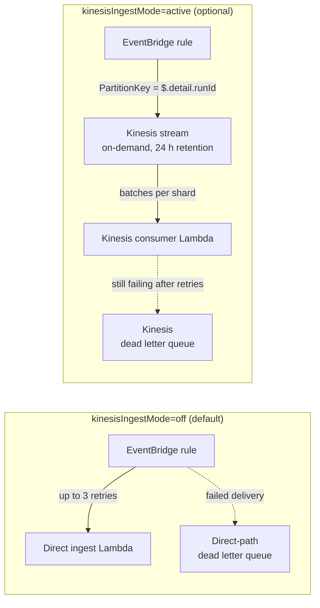
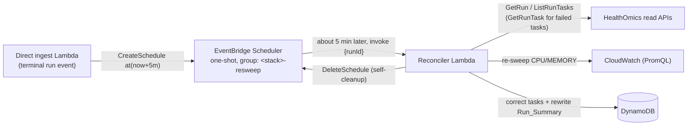

# Ingest architecture and internals

This page covers the ingest path in detail: the two configuration flags, how
events are turned into run and task state, the event fields the mapper reads,
how the run detail view merges live updates, and the deferred re-sweep. The
[README](../README.md#architecture) has the overview.

- [Ingest path modes (`kinesisIngestMode`)](#ingest-path-modes-kinesisingestmode)
- [Event-driven enrichment (`eventEnrichmentMode`)](#event-driven-enrichment-eventenrichmentmode)
- [Event metadata reference](#event-metadata-reference)
- [Live updates in the run detail view](#live-updates-in-the-run-detail-view)
- [Deferred re-sweep](#deferred-re-sweep)
- [Ingest IAM](#ingest-iam)
- [AWS SDK bundling](#aws-sdk-bundling)

## Ingest path modes (`kinesisIngestMode`)

`kinesisIngestMode` selects how the Amazon EventBridge rule
(`source = aws.omics`, default bus) delivers events to ingest. It is a CDK
context flag (`-c kinesisIngestMode=<mode>`, `infra/lib/ingest-stack.ts`).
The default is `off`, the direct path; the Kinesis buffer is opt-in:

| Mode | EventBridge target | Kinesis resources | Notes |
|------|--------------------|-------------------|-------|
| `off` (default) | Direct ingest Lambda (up to 3 retries, then the direct-path dead letter queue) | None | No fixed stream charge. Each event is one Lambda invocation. |
| `present` | Direct ingest Lambda | Stream, Kinesis consumer Lambda, event source mapping, Kinesis dead letter queue, all idle | Lets you deploy and check the Kinesis resources before switching. The stream still bills. |
| `active` | Amazon Kinesis Data Streams stream, partition key `$.detail.runId` | Stream, Kinesis consumer Lambda, event source mapping, Kinesis dead letter queue | Bursts queue in the stream instead of using Lambda concurrency per event. |

Use `active` when large batches of task-heavy runs could hit Lambda
concurrency limits or throttling on the direct path. The trade-offs are the
fixed on-demand stream charge (about $29/month, even when idle) and no
deferred re-sweep on the Kinesis path (see [Deferred re-sweep](#deferred-re-sweep)).

Switching modes is a context change plus a redeploy. Pass the same mode on
every deploy, because a deploy without the flag returns to `off`. The toggle never deletes
the direct ingest Lambda, so moving between `active` and `present` or `off` is
one deploy in either direction. Moving to `off` removes the stream from the
stack, but the stream has a `RETAIN` policy, so it stays in the account (and
keeps billing) until you delete it.



Both Lambdas run the same pipeline (`ingest/src/kinesisHandler.ts` calls the
handler from `ingest/src/handler.ts`), so the downstream writes and publishes
are identical.

Kinesis consumer Lambda settings:

- 192 MB memory, 60 s timeout, no reserved concurrency.
- Event source mapping: batch size 100, parallelization factor 10,
  `ReportBatchItemFailures`, bisect on error, 5 retries, 1 hour maximum
  record age, on-failure destination the Kinesis dead letter queue.
- Concurrency is shards × parallelization factor, so a large batch of
  task-heavy runs waits in the stream rather than fanning out.
- 192 MB leaves headroom over the peak observed while parsing a workflow
  definition bundle.

Kinesis was chosen over Amazon SQS FIFO because EventBridge can write to
Kinesis with a dynamic partition key directly, with no enqueue Lambda or
bridging queue. The cost is the fixed on-demand stream charge (see
[cost.md](cost.md)).

The direct ingest Lambda also has 192 MB memory (at 128 MB the same pipeline
peaked at 115 MB and once hit 128/128 while parsing a workflow definition
bundle). It keeps a reserved concurrency of 400 in every mode,
paired with `OMICS_TPS=0.025` so that 400 × 0.025 stays within the HealthOmics
run-read budget of about 10 TPS. Only events that call HealthOmics use the
rate limiter, so the cheap majority (a DynamoDB write and an AppSync publish)
drains quickly.

## Event-driven enrichment (`eventEnrichmentMode`)

HealthOmics task events (`omicsVersion` 1.0.0) carry the task's name,
resources, and timing, so ingest builds task and run state from the event
payload instead of calling HealthOmics for every task. The policy is the CDK
context flag `-c eventEnrichmentMode=<mode>`, passed to both ingest Lambdas as
`EVENT_ENRICHMENT_MODE` (`infra/lib/ingest-stack.ts`, `ingest/src/handler.ts`).
An invalid value fails synth.

- `event` (default): state comes from the event. HealthOmics read APIs are
  called only when the event cannot supply a field:
  - `GetRun` at run `PENDING` (parameters, configuration, exact `createdAt`)
    and at a terminal run status (exact `stoppedAt`, status message). It is
    also called on a `STARTING`, `RUNNING`, or `STOPPING` event if the stored
    run has no `GetRun` data yet (for example, the `PENDING` event was
    missed).
  - `GetRunTask` only for `FAILED` or `CANCELLED` tasks (events never carry
    `statusMessage` or `failureReason`), or for a terminal task event missing
    its name, start time, or stop time.
  - `GetWorkflow` only when the workflow version's graph is not stored yet
    (cache key `workflowId` + `workflowVersionName`). A failed fetch or parse
    is cached for 1 hour (`GRAPH_FAILURE_RETRY_WINDOW_MS`), so a broken
    definition is not retried on every run event.
- `shadow`: same as `event`, plus `GetRunTask` on every terminal task event to
  check the event values. Each field that differs (name, cpus, memory,
  instanceType, createdAt, startedAt, stoppedAt) logs
  `enrichment_shadow_mismatch` and emits the EMF metric
  `HealthOmicsIngest/EnrichmentShadowMismatch` with dimension `field`. On
  every terminal task event, all seven compared fields are then written from
  `GetRunTask`, so terminal values never depend on unchecked event data. Use
  it to re-check event data after an ingest change.
- `api`: the legacy behavior, kept for rollback. `GetRun` on every run event
  and `GetRunTask` on every terminal task event.

On a 207-task nf-core/rnaseq run, `event` mode made 2 HealthOmics calls in
total (`GetRun` at `PENDING` and at terminal), compared with 217 under the
legacy path (about one `GetRunTask` per task plus the run calls). Every
processed event writes one structured `ingest_event` log line with an
`apiCalls` count (`GetRun`, `GetRunTask`, `GetWorkflow`), so the call volume
can be checked in Amazon CloudWatch Logs.

```bash
cd infra
npx cdk deploy --all                                # defaults: off + event
npx cdk deploy --all -c eventEnrichmentMode=shadow  # check event data
npx cdk deploy --all -c eventEnrichmentMode=api     # rollback
```

`scripts/deploy.sh` does not set `eventEnrichmentMode`, so it deploys the
default `event` mode. Use `npx cdk deploy` directly for `shadow` or `api`.

## Event metadata reference

The fields the ingest mapper reads from HealthOmics events (`omicsVersion`
1.0.0) are defined in `ingest/src/eventMapper.ts`. Observed statuses are
`PENDING`, `STARTING`, `RUNNING`, `STOPPING`, `COMPLETED`, `FAILED`, and
`CANCELLED`.

Task Status Change (`detail-type: "Task Status Change"`):

| Event field | Dashboard field | Carried on |
|-------------|-----------------|------------|
| `arn` (`.../task/<task-id>`) | `taskId` (parsed from the ARN) | All statuses |
| `runId` | `runId` | All statuses |
| `status` | `status` | All statuses |
| `taskName` (not `name`) | `name` | All statuses |
| `cpus` (string, e.g. `"2"`) | `cpus` (number) | All statuses |
| `memory` (string, GiB) | `memory` (number, GiB) | All statuses |
| `gpus` (string) | Not mapped (no `gpus` field in the schema) | All statuses |
| `creationTime` | `createdAt` | All statuses |
| `instanceType` | `instanceType` | Added at `RUNNING` |
| `startTime` | `startedAt` | Added at `RUNNING` |
| `stopTime` | `stoppedAt` | Added at `COMPLETED` |
| *(not carried)* `statusMessage`, `failureReason` | From `GetRunTask` | `FAILED` / `CANCELLED` only |

Numeric values arrive as strings, and timestamps match `GetRunTask`. Because
task events never carry `statusMessage` or `failureReason`, `GetRunTask` is
still called for `FAILED` and `CANCELLED` tasks. The shape of those two events
has not been checked against live data. The mapper still reads a legacy `name`
field as a fallback, which is what the sample
`fixtures/events/task-status-change.json` uses.

Run Status Change (`detail-type: "Run Status Change"`):

| Event field | Dashboard field | Carried on |
|-------------|-----------------|------------|
| `runId` | `runId` | All statuses |
| `status` | `status` | All statuses |
| `runName` | `name` | All statuses |
| `workflowId` | `workflowId` | All statuses |
| `workflowName` | `workflowName` | All statuses |
| `workflowVersionName` | `workflowVersionName` (optional) | All statuses, when the run has a version |
| `runOutputUri` | `outputUri` (optional) | All statuses |

Run events carry only identity, `workflowVersionName`, and `runOutputUri`.
Timestamps, parameters, run configuration, engine version, and status messages
come from `GetRun` at `PENDING` and at terminal. Until `GetRun` supplies them,
`event` mode uses the event `time` as `createdAt` at `PENDING` and as
`startedAt` at `RUNNING`.

## Live updates in the run detail view

The run detail view (`frontend/src/rundetail/RunDetailView.tsx`,
`frontend/src/rundetail/mergeTasks.ts`) applies `onTaskUpdated` and
`onRunUpdated` messages monotonically. It never moves a task or run from a
terminal status back to a non-terminal one, and otherwise keeps the record
with the newer `updatedAt` (for tasks, an `updatedAt` tie goes to the higher
status rank).

It re-syncs the task list with one `listTasksForRun` query (a DynamoDB read,
no HealthOmics calls) after an Amplify reconnect, when the task subscription
is acknowledged, when the tab becomes visible, when the browser comes back
online, and once when the run reaches a terminal status.

## Deferred re-sweep

> The deferred re-sweep runs on the default direct path (`kinesisIngestMode`
> `off` or `present`). Only the direct ingest Lambda gets the
> `RECONCILER_*` environment variables, so it does not run on the optional
> Kinesis path (`active`). Wiring it into the Kinesis consumer Lambda would
> add HealthOmics calls per run, so it is a separate decision. See
> [Known limitations](../README.md#known-limitations).

A run's performance rollup (`Run_Summary`) is computed when the run reaches a
terminal status. At that moment two things may not have settled:

1. Task states. EventBridge delivers events at least once and possibly out of
   order. In `event` mode, out-of-order events are handled by the monotonic
   `updatedAt` and status guards on every upsert. The re-sweep is the
   backstop for a task whose terminal event was lost or arrived late, which
   would otherwise leave it stored as non-terminal.
2. Utilization metrics. HealthOmics emits CPU and memory utilization about
   every 30 seconds, and CloudWatch ingestion trails the terminal event by
   tens of seconds to minutes. The terminal-time metric sweep often records
   "utilization unavailable" even though the data lands shortly afterward.

When a run reaches a terminal status, the direct ingest Lambda creates a
one-shot
[Amazon EventBridge Scheduler](https://docs.aws.amazon.com/scheduler/latest/UserGuide/what-is-scheduler.html)
schedule (`at(now + RECONCILE_DELAY_MINUTES)`, default 5 minutes) that invokes
the Reconciler Lambda with `{ runId }`. The Reconciler Lambda:

1. Re-reads the run and all task state from HealthOmics (one `GetRun`,
   `ListRunTasks` pages of 100, and `GetRunTask` only for `FAILED` or
   `CANCELLED` tasks) and re-upserts each task. The monotonic and
   terminal-status guards make a redundant write a no-op.
2. Re-sweeps CloudWatch for the now-available utilization series.
3. Recomputes the `Run_Summary`, writes it with a new `updatedAt` so it wins
   the monotonic guard, and refreshes the `Group_Registry`.
4. Deletes its own schedule (the schedule also uses
   `ActionAfterCompletion: DELETE`), so nothing accumulates.



The re-sweep is idempotent and isolated from failures. If everything already
settled, it changes nothing, and a scheduling failure never touches the
summary that was already written. The ingest handler schedules a re-sweep only
when `RECONCILER_FUNCTION_ARN` and `RECONCILER_SCHEDULER_ROLE_ARN` are set in
its environment, and skips it otherwise. The delay is set with the
`RECONCILE_DELAY_MINUTES` environment variable.

The Reconciler Lambda has a reserved concurrency of 2 with `OMICS_TPS=5`, so a
wave of re-sweeps stays within about 10 TPS of HealthOmics reads, and a single
207-task run finishes well inside the 300-second timeout.

## Ingest IAM

Every ingest role uses explicit action lists and scoped resources:

- Direct ingest Lambda and (when Kinesis is enabled) Kinesis consumer Lambda:
  - HealthOmics read-only: `GetRun`, `ListRunTasks`, `GetRunTask`,
    `GetWorkflow`, scoped to the deployment account and region's run and workflow ARNs.
  - `appsync:GraphQL` on the `publishRunUpdate` and `publishTaskUpdate`
    mutation fields only.
  - DynamoDB read/write on the table and `GSI1`.
  - The Kinesis consumer Lambda also gets stream read access from its event
    source mapping.
- The direct ingest Lambda can also call `scheduler:CreateSchedule` within the
  re-sweep schedule group, and `iam:PassRole` on the single scheduler-invoke
  role, conditioned on `iam:PassedToService = scheduler.amazonaws.com`.
- Reconciler Lambda: HealthOmics run reads, CloudWatch `GetMetricData` and
  `ListMetrics` (`Resource: *`, because these actions do not support
  resource-level scoping), DynamoDB read/write on the table, `GSI1`, and
  `GSI2`, and `scheduler:DeleteSchedule` within its own group.
- The scheduler-invoke role is trusted only by EventBridge Scheduler and may
  only invoke the Reconciler Lambda.

## AWS SDK bundling

The IngestStack Lambdas (direct ingest, Reconciler, and the optional Kinesis consumer)
bundle the pinned AWS SDK for JavaScript v3 clients instead of using the SDK
in the Lambda runtime. The ApiStack resolver Lambdas use the runtime SDK. The runtime SDK is older and does not
deserialize newer `GetRun` response fields (for example `networkingMode`,
`configuration`, and `vpcConfig`), which were dropped during enrichment before
the change. Because the bundle is ESM, a `createRequire` banner lets the SDK's
CommonJS `require` calls resolve.
